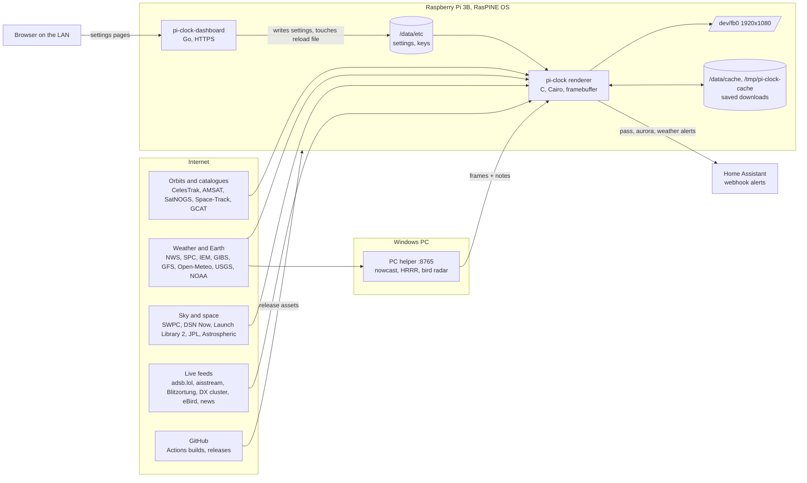

# Pi-Clock architecture

This describes the `geochron-features` branch of the fork
`scimaksim/Pi-Clock` as of 14 Nov 2026 (build `fork-2026-11-14-dfd825f`).
Upstream Pi-Clock is by Andy Taylor (MW0MWZ).

## Diagram

## Components

**Renderer (`renderer/`, C).** One process, `pi-clock`, draws straight to
the Linux framebuffer with Cairo; there is no X11 or Wayland. About 120
source files and 50,000 lines. `display.c` owns the main loop: it builds
the layer stack, starts the features, picks the current view, composites
and writes the frame.

**Layers and applets.** Every visual element is a layer with its own
ARGB surface, redraw interval, opacity and on/off flag (`layer.c`).
Layers are composited bottom to top, and a layer is only redrawn when
its interval has passed or its data changed, so slow layers cost nothing
between updates. Side panels ("applets", `applet.c`) stack down the left
and right edges. There are about 60 map layers and 17 applets.

**Features (`feature.c/.h`).** Most overlays are a `pic_feature_t`: a
background thread that fetches on a schedule (`work`), a mutex-protected
snapshot the main thread reads, a render function, and optional legend,
idle test and reload hooks. `features_all.h` is the table `display.c`
starts, reloads and stops them from. A feature's thread runs only while
its layer or applet is on. Features that need the network wait for it
(`pic_wait_for_network`, which never gives up; a two-minute variant lets
a feature fall back to its saved copy).

**Fetching (`fetch.c`).** All downloads go through `wget` run as a child
process, to a buffer or a file, with TLS verification on. A non-zero
exit is a failure unless the buffer was filled. CelesTrak requests are
rate-held because CelesTrak blocks addresses that ask too often.
`datastatus.c` records each source's last success for the dashboard.

**Views.** `VIEW_MODE=cycle` rotates: global map 5 min, local map 5 min,
then the Moon, Mars and Jupiter 2 min each (`planetview.c`). The local
view is a zoom around home with its own detail map (`localmap.dat`),
towns and state lines. Layers can be limited to the global or the local
view. `pic_config.viewport_gen` changes with every view change so cached
drawings and label boxes from the old view are dropped.

**Base map.** Day and night maps (Blue Marble, Black Marble) blended by
the Sun's position. `season.c` overlays a cloud-free composite of recent
VIIRS daily imagery from NASA GIBS so snow and leaf colour follow the
season: a 12-day window ending on the newest day that has imagery
(looked for up to 30 days back), keeping a pixel only when at least
three days saw it.

**Satellites.**
- `satellite.c` propagates orbits with SGP4 and predicts passes.
- `layers_satellite.c` draws the chosen tracked satellites, with crew
  counts for the ISS and Tiangong (`crew.c`).
- `layers_overhead.c` draws every low-orbit satellite now in view, from
  three element sources: CelesTrak's brightest list (Space-Track as the
  fallback), SatNOGS and AMSAT. In the local view a satellite that no
  longer works carries a note from GCAT (`gcat.c`): "defunct Apr 2012"
  is the end-of-transmission date, "retired Mar 1984" marks one GCAT
  flags as uncontrolled but still sending a beacon. A satellite GCAT
  lists as working, or does not list, gets no note. The catalogue is
  re-downloaded every three days.
- `spacetrack.c`, `spacedata.c`, `spacelayers.c`, `layers_spacetrack.c`:
  re-entries, close approaches, the geostationary belt from home, newest
  debris and catalogue totals, using the owner's Space-Track account.
  The data is only displayed, never redistributed.
- `layers_starlink.c`, `layers_launches.c`, `launchvis.c`: Starlink
  trains, upcoming launches (shown within `LAUNCH_DAYS`, default 1 day,
  of liftoff) and whether an ascent can be seen from home.

**Label placement (`labels.c`).** A shared registry of label boxes.
Each owner (Space-Track layers, launches, planets, Starlink trains,
storms, satellites) asks for a free spot among eight candidates around
its marker; the registry keeps labels off each other, the clocks, the
side panels and the bottom notes. Boxes expire with the view or after
300 s.

**Weather and Earth.** NWS alerts (`nwsalert.c`), SPC outlooks, storm
reports, NEXRAD radar, rain totals, river gauges, drought, GFS rain and
wind, satellite clouds (GOES/Himawari via GIBS), sea surface
temperature, fires and smoke, air quality, lightning, earthquakes,
volcanoes, tropical storms.

**Sky.** Sun, Moon, planets (`sky_icons.c`, `planetmath.c`, `astro.c`),
eclipses (`eclipse.c` with generated tables), aurora oval and Aurora
Watch, light pollution, dark-sky sites, the Deep Space Network, and the
Tonight's Sky applet (Astrospheric).

**Radio.** DX cluster spots and feed, propagation prediction and MUF,
CQ/ITU zones, Maidenhead grid, solar weather.

**Other worlds (`planetview.c`).** Moon, Mars and Jupiter views with
named features from the IAU gazetteer, rover positions and their latest
pictures, DSN links per spacecraft, and Jupiter's Galilean moons.

**Dashboard (`dashboard/`, Go).** A single static binary with the web
pages embedded, served over HTTPS with a self-signed certificate. It
edits the files in `/data/etc`, then touches `/tmp/pi-clock-reload`;
the renderer checks for that file each frame and re-reads its settings
(a SIGHUP does the same). API keys and the Space-Track sign-in are
write-only: the dashboard never returns them. Empty saves are refused,
and settings files are written atomically.

**PC helper (`helper/`, Python).** Runs jobs a Pi cannot, on a PC on the
same network, and serves frames to the clock on port 8765: the rain
nowcast (MRMS radar extrapolated 90 min), HRRR cloud, smoke, gust and
frost forecasts, and bird migration from NEXRAD with MistNet. When the
PC is off the clock keeps the last frames while they are valid, then
hides the layers.

**Home Assistant (`ha_notify.c`, `docs/home-assistant.md`).** The clock
posts alerts to a Home Assistant webhook, backing off from 1 to 30
minutes when it fails.

**OS (`os/`).** RasPINE: Raspberry Pi kernel with an Alpine userland,
A/B root partitions and a persistent `/data` partition. `pi-clock-upgrade`
installs to the inactive slot; `pi-clock-rollback` returns to the other.

## Files on the Pi

| Path | Holds |
|---|---|
| `/usr/bin/pi-clock`, `/usr/bin/pi-clock-dashboard` | the two programs (`pi-clock.prev` is the previous renderer) |
| `/usr/share/pi-clock/` | maps, `localmap.dat`, other-world maps and sprites |
| `/data/etc/pi-clock-renderer.conf` | renderer settings (home, view mode, options) |
| `/data/etc/pi-clock-layers.conf` | `name=on,opacity[,view]` per layer |
| `/data/etc/pi-clock-applets.conf` | applets and their side |
| `/data/etc/pi-clock-*.key`, `pi-clock-spacetrack.cred`, `pi-clock-ha-webhook` | secrets, root-only; never logged or shown |
| `/data/cache/` | downloads worth keeping across restarts: season tiles, Space-Track data, GCAT catalogue, health log |
| `/tmp/pi-clock-cache/` | short-lived downloads (element sets) |
| `/var/log/pi-clock-renderer.log` | renderer log, trimmed when it passes 4 MB |

## Rules the code keeps

- Old data is never shown as current. `pic_data_stale()` hides or marks
  each feed past its limit (aircraft 3 min, ships 10 min, aurora 2 h,
  air quality 3 h, storms 12 h, wind 18 h, and so on).
- Nothing guessed is shown as fact. A source that is missing leaves its
  layer empty or labelled, and a parser that cannot read a reply reports
  failure and keeps the last good data.
- Secrets stay on the Pi, in root-only files, and are sent only to the
  service they belong to.
- TLS verification is never turned off.
- Data-source terms are followed: CelesTrak's rate limits, Space-Track's
  no-redistribution rule. Credits are in `CREDITS.md`.

## Build, test and release

- Renderer tests: `cd renderer/tests && make check` (host build, no
  network; tests use made-up data). Dashboard: `go vet ./... && go test ./...`.
- GitHub Actions on every push to `geochron-features`: the test workflow,
  and "Build Fork OS Image", which publishes a release
  `fork-YYYY-MM-DD-<sha7>` with the armhf renderer and dashboard,
  `localmap.dat`, `worlds.tar` and `binaries.sha256` (about 13 minutes).
- Install on the Pi: fetch the five assets, check them against
  `binaries.sha256`, keep the old renderer as `pi-clock.prev`, stop the
  service, copy the files in, start it. Settings in `/data/etc` are not
  touched.

## Known gaps

- Earthquake, volcano and storm-report labels, and satellite labels in
  the local view, do not yet use the shared label registry.
- Saving WiFi from the dashboard replaces the other saved networks.
- The dashboard log is not trimmed.
- Moonrise times can be off by about four minutes; band conditions are a
  rule of thumb, not a full prediction.

## History

- 2026-11-14: defunct and retired dates from GCAT in the local view;
  season map window follows the newest imagery; shared label registry;
  stale-data rule; alert, radar and Home Assistant hardening; two review
  passes.
- 2026-11 (earlier): Space-Track layers, other-world views, PC helper,
  eclipse views, local view and the view cycle.
